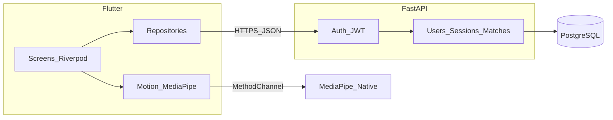

# Reescrita MS Upper Limbs (Flutter + SQL + MediaPipe)

## Decisões fechadas

- **Persistência:** PostgreSQL via API (sem Firebase/Firestore).
- **Auth:** email + senha + JWT (access/refresh) — sem Google Sign-In nesta versão.
- **App:** Flutter novo na raiz do repo; [`old/`](old/) fica só como referência (não se copia código cegamente).
- **ML:** unificar em **MediaPipe nativo** (pose + hands) atrás de uma interface Dart única; Android primeiro; iOS com o mesmo contrato.
- **Ordem:** bootstrap → auth/home → câmera/ML → **FNose** → **Rapid** (ambos obrigatórios).
- **Backend:** FastAPI + SQLAlchemy 2 + Alembic + Postgres.

## O que preservar do legado

Fonte: [`old/msupperlimbs-main/msupperlimbs-main/doc/AppFlow.md`](old/msupperlimbs-main/msupperlimbs-main/doc/AppFlow.md) + MDs de câmera.

**Preservar** (comportamento e campos, não o código):

- Fluxos de ecrã FNose e Rapid
- Estados do jogo, thresholds e settings (básicas + avançadas)
- Sessão diária `YYYYMMDD`, matches, chunks de pose/touch/tap
- Configs de câmera por device
- Consentimento no registo (boolean + timestamp)

**Não preservar:** Firebase, código morto ML Kit/MediaPipe duplicado, providers duplicados, bug de path em `sessionExists`, widgets `_old`, channel `com.example/native`.

## Arquitetura alvo

Estrutura na raiz:

- `mobile/` — Flutter feature-first
- `backend/` — FastAPI + Alembic
- `docs/` — inventário, AppFlow, schema SQL
- `old/` — referência imutável

## Schema SQL (espelho do Firestore)

- `users` — email, password_hash, name, consent_at, last_access
- `fnose_settings` / `fnose_adv_settings` / `rapid_settings` — 1:1 com user
- `sessions` — unique(user_id, date YYYYMMDD)
- `session_logs`
- `fnose_matches` + `fnose_pose_chunks` / `fnose_touch_chunks` (JSONB)
- `rapid_matches` + chunks de pose/tap/pulse (JSONB)
- `fnose_global_stats` / `fnose_recent_matches`
- `camera_image_configs`

## Login simples

- `POST /auth/register` — email, senha, nome, consent
- `POST /auth/login` — JWT access + refresh
- Flutter: uma tela login/registo; `go_router` redirect; sem Google/Firebase
- Pós-login: settings default + sessão do dia (igual ao fluxo atual)

## Flutter — práticas alvo

- SDK atual + FVM + `pubspec.lock` commitado
- Riverpod + `go_router` com `redirect`
- Feature: `data` / `domain` / `application` / `presentation` / `motion`
- Detector abstrato → MediaPipe nativo
- l10n desde o início; testes nas regras de jogo

## MediaPipe — unificação

1. DTO Dart estável (landmarks + timestamp + confiança).
2. Android: pose + hands nativos; channel com package real (não `com.example`).
3. Não portar `google_mlkit_*` no app novo.
4. Spike: frame → landmarks → overlay debug antes de FNose/Rapid.

## Fases

| Fase | Entrega |
|------|---------|
| 0 | Inventário do legado em `docs/` |
| 1 | `mobile/` + `backend/` + Docker Postgres |
| 2 | Auth JWT + home |
| 3 | Câmera + spike MediaPipe |
| 4 | FNose completo + SQL |
| 5 | Rapid completo + SQL |
| 6 | Testes, deploy, migração Firestore→SQL opcional |

## Método de revisão contínua

Em cada módulo do `old/`, aplicar três lentes antes de reimplementar:

1. **Redundância** — service só-proxy, providers duplicados, duas stacks ML
2. **Desalinhamento** — paths/campos inconsistentes, nomenclatura legada
3. **Obsoleto** — Firebase client, widgets `_old`, deps mal classificadas

Regra: **regras e campos sim; estrutura Firebase não.**

## Fora de escopo inicial

- Google Sign-In e Firestore em paralelo
- iOS polished (Android-first)
- `old/msproto-master` (ignorar salvo referência pontual)
